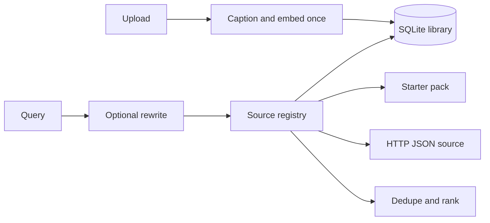

# memeframe

English · [中文说明](README.zh-CN.md)

Meme search framework. It borrows the useful part of [o98k-ok/meme](https://github.com/o98k-ok/meme) — a source registry, concurrent fan-out, per-source errors, and MCP — and adds the pieces that project does not have: a local library, upload, and captions written once at ingest.

Search itself stays cheap. A query does not call a vision model or an embedding API.

## What you can run today

- `library` — images you upload. A caption and one text embedding are stored with the file.
- `starter` — six original placeholder scenes, in Chinese and English, so search works on an empty library.
- `http` — a remote JSON adapter. It stays disabled until you set a URL.
- Web UI with a Chinese / English switch.
- MCP tools: `search_meme`, `list_sources`, `upload_meme`.
- Optional query rewrite. Off unless `MEMEFRAME_AGENT=1` and an API key are both set.

Live scrapers for sites such as 斗图啦, 搜狗表情, or 抖音 are not included. Those adapters depend on unofficial pages, cookies, and hotlink proxies, and they break. The `Source` class is the extension point if you still want one.

## Layout



| | o98k-ok/meme | shengchao73/meme-mcp | emomo | memeframe |
| --- | --- | --- | --- | --- |
| Concurrent sources | yes | no | ingest pipeline | yes |
| MCP | yes | yes | no | yes |
| Upload | no | local folder | yes | yes |
| Caption at ingest | no | no | yes | optional, once |
| Vision call on search | no | no | no | no |
| Chinese and English | Chinese | Chinese | product UI | UI, data, docs |

## Quick start

```powershell
python -m venv .venv
.\.venv\Scripts\Activate.ps1
pip install -e .
memeframe serve
```

Open `http://127.0.0.1:8000`. Try `画饼` or `speechless cat`.

```powershell
memeframe search 画饼
memeframe sources
memeframe upload .\some-image.png --title "无语的猫" --title-en "Speechless cat" --tags "猫,cat"
memeframe reindex
python -m unittest discover -s tests -v
```

Embeddings are always a local hash of the caption text, so library search stays offline even with an API key. Without a key, captions fall back to the title you typed. Set a key only when you want a vision caption at upload time (or optional query rewrite):

```powershell
$env:MEMEFRAME_API_KEY = "your-key"
$env:MEMEFRAME_BASE_URL = "https://dashscope.aliyuncs.com/compatible-mode/v1"
$env:MEMEFRAME_CAPTION_MODEL = "qwen-vl-plus"
```

Copy `.env.example` to `.env` if you would rather not export variables. Existing environment variables win.

## MCP

```powershell
python -m memeframe.mcp_server
```

Cursor config lives in `examples/mcp.json`. Point `command` at the virtualenv Python if the global one does not have this package.

`search_meme` reads the index. `upload_meme` is the only tool that can call a caption model.

## Add a source

Subclass `Source` and register it in `build_context`:

```python
class ExampleSource(Source):
    id = "example"
    name = "示例 · Example"
    description = "Your adapter / 你的适配器"
    enabled = True

    def search(self, keyword: str, options: SearchOptions) -> list[Meme]:
        return []
```

A remote API can skip that class and use the built-in HTTP source:

```text
GET {MEMEFRAME_HTTP_SOURCE_URL}?q=猫&page=1&limit=10
{"memes": [{"title": "猫", "url": "https://example.com/cat.gif", "format": "gif"}]}
```

If some images need a hotlink proxy, set `IMAGE_PROXY_URL` to a template containing `{URL}` and `{REFERER}`. Local `/media/...` URLs are left alone.

## Environment

| Variable | Default | Use |
| --- | --- | --- |
| `MEMEFRAME_HOME` | `data` | SQLite file and uploads |
| `MEMEFRAME_AGENT` | `0` | `1` rewrites a query before search |
| `MEMEFRAME_API_KEY` | empty | Caption and rewrite only |
| `MEMEFRAME_BASE_URL` | DashScope compatible mode | OpenAI-compatible endpoint |
| `MEMEFRAME_CAPTION_MODEL` | `qwen-vl-plus` | Upload only |
| `MEMEFRAME_REWRITE_MODEL` | `qwen-turbo` | Only when the agent flag is on |
| `MEMEFRAME_HTTP_SOURCE_URL` | empty | Enables the `http` source |
| `MEMEFRAME_HTTP_SOURCE_HEADER` | empty | Optional `Header: value` for the HTTP source |
| `MEMEFRAME_MAX_UPLOAD_BYTES` | `5242880` | Upload size limit |
| `IMAGE_PROXY_URL` | empty | Remote image proxy template |
| `MEMEFRAME_SOURCE_TIMEOUT` | `8` | Seconds for each source |

`memeframe reindex` rebuilds embeddings from captions already stored. It does not look at the images again.
