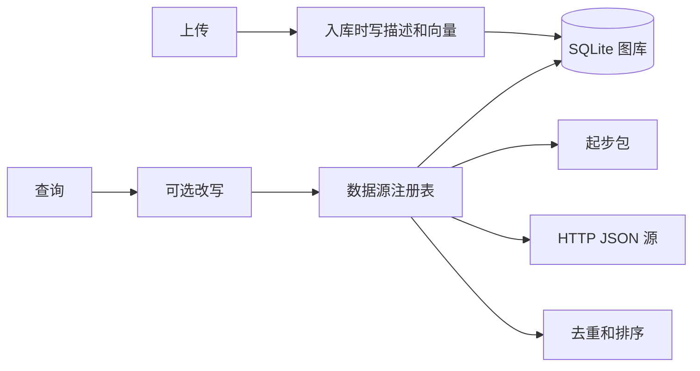

# memeframe

[English](README.md) · 中文

梗图搜索框架。多源并发、单个源失败不影响其他源、MCP，这几件来自 [o98k-ok/meme](https://github.com/o98k-ok/meme)。它没有的部分补在这里：本地图库、上传，以及只在入库时写一次的描述和向量。

搜索本身保持便宜。一次查询不会调用视觉模型。

## 现在就能跑的部分

- `library`：你上传的图。文件、一句描述、一条文本向量存在一起。
- `starter`：六张原创占位场景，中英都有，空库也能搜。
- `http`：远程 JSON 适配器。没填地址就保持关闭。
- 网页可以在中文和 English 之间切换。
- MCP 工具：`search_meme`、`list_sources`、`upload_meme`。
- 可选的查询改写。只有 `MEMEFRAME_AGENT=1` 并且填了 API key 才会打开。

斗图啦、搜狗表情、抖音这类站点的爬虫没有放进来。它们依赖非官方页面、Cookie 和防盗链代理，而且很容易坏。真要接，就实现一个 `Source`。

## 结构



| | o98k-ok/meme | shengchao73/meme-mcp | emomo | memeframe |
| --- | --- | --- | --- | --- |
| 多源并发 | 有 | 无 | 采集管道 | 有 |
| MCP | 有 | 有 | 无 | 有 |
| 上传 | 无 | 本地文件夹 | 有 | 有 |
| 入库时写描述 | 无 | 无 | 有 | 可选，只做一次 |
| 搜索时看图 | 无 | 无 | 无 | 无 |
| 中英 | 中文 | 中文 | 产品界面 | 界面、数据和文档 |

## 开始

```powershell
python -m venv .venv
.\.venv\Scripts\Activate.ps1
pip install -e .
memeframe serve
```

打开 `http://127.0.0.1:8000`。可以搜 `画饼`，也可以搜 `speechless cat`。

```powershell
memeframe search 画饼
memeframe sources
memeframe upload .\some-image.png --title "无语的猫" --title-en "Speechless cat" --tags "猫,cat"
memeframe reindex
python -m unittest discover -s tests -v
```

没有 API key 时，描述就用你填的标题，向量用这段文字的本地哈希。只有希望上传时让视觉模型写描述，才需要 key：

```powershell
$env:MEMEFRAME_API_KEY = "your-key"
$env:MEMEFRAME_BASE_URL = "https://dashscope.aliyuncs.com/compatible-mode/v1"
$env:MEMEFRAME_CAPTION_MODEL = "qwen-vl-plus"
$env:MEMEFRAME_EMBED_MODEL = "text-embedding-v3"
```

也可以把 `.env.example` 复制成 `.env`。已经存在的环境变量优先。

## MCP

```powershell
python -m memeframe.mcp_server
```

Cursor 的配置在 `examples/mcp.json`。如果全局 Python 没装这个包，把 `command` 指到虚拟环境里的 Python。

`search_meme` 只读索引。会调用描述模型的只有 `upload_meme`。

## 加一个数据源

继承 `Source`，在 `build_context` 里注册：

```python
class ExampleSource(Source):
    id = "example"
    name = "示例 · Example"
    description = "你的适配器 / Your adapter"
    enabled = True

    def search(self, keyword: str, options: SearchOptions) -> list[Meme]:
        return []
```

远程接口也可以不写类，直接用内置的 HTTP 源：

```text
GET {MEMEFRAME_HTTP_SOURCE_URL}?q=猫&page=1&limit=10
{"memes": [{"title": "猫", "url": "https://example.com/cat.gif", "format": "gif"}]}
```

图片需要防盗链代理时，把 `IMAGE_PROXY_URL` 设成包含 `{URL}` 和 `{REFERER}` 的模板。本地的 `/media/...` 不会被改写。

## 环境变量

| 变量 | 默认 | 作用 |
| --- | --- | --- |
| `MEMEFRAME_HOME` | `data` | SQLite 和上传文件 |
| `MEMEFRAME_AGENT` | `0` | 设为 `1` 时，搜索前先改写查询 |
| `MEMEFRAME_API_KEY` | 空 | 描述、向量、改写 |
| `MEMEFRAME_BASE_URL` | 百炼兼容模式 | OpenAI 兼容接口 |
| `MEMEFRAME_CAPTION_MODEL` | `qwen-vl-plus` | 只在上传时用 |
| `MEMEFRAME_EMBED_MODEL` | `text-embedding-v3` | 上传和查询文本 |
| `MEMEFRAME_REWRITE_MODEL` | `qwen-turbo` | 只在打开 Agent 时用 |
| `MEMEFRAME_HTTP_SOURCE_URL` | 空 | 填了才启用 `http` 源 |
| `IMAGE_PROXY_URL` | 空 | 远程图片代理模板 |
| `MEMEFRAME_SOURCE_TIMEOUT` | `8` | 每个源的超时秒数 |

`memeframe reindex` 用已经存好的描述重建向量，不会重新看图。
